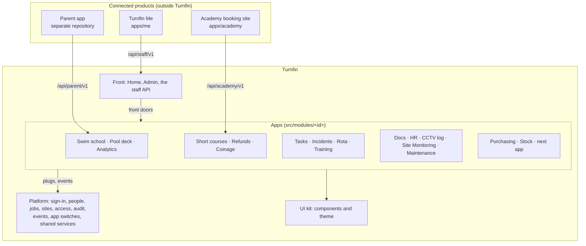

# Turnfin 2.0: the architecture

How Turnfin 2.0 is built: the platform, the apps on it, how they connect, who can do what, the connected products and the databases. What Turnfin is for is in [../PRODUCT.md](../PRODUCT.md). The rules for changing the code are in [../AGENTS.md](../AGENTS.md). The order the work happens in is in [roadmap.md](roadmap.md).

Each section says what is **built** and, where 2.0 changes it, what is **planned**, with the roadmap step that delivers it.

## The shape in one paragraph

Turnfin is **one Next.js app, one deploy, one sign-in**, built as a platform with apps on top (a "modular monolith", the shape Shopify, Odoo, Salesforce and ServiceNow use). The platform does what every app needs and never knows which apps exist. Each app is a sealed folder with a six-part contract, owns its own data and talks to the others only through that contract. An app can grow as large as a product sold on its own, can be switched off without breaking the rest, and could be lifted out later because it already owns its data. Connected products live outside Turnfin and use versioned APIs only.

We do not split Turnfin into separately deployed services: that moves breakage into the network between them, multiplies deploys and logs, and slows every cross-app job (an incident that needs HR, a class Rota must cover). The contract keeps that door open without paying the price now.

## Layers and folders

| Layer | Folders | Holds |
| --- | --- | --- |
| **Platform** | `src/lib`, `src/auth.ts`, `src/platform/events`, `src/modules/{registry,contributions,context,server,session-hooks}.ts`; its admin screens in `src/app/(core)` and `src/components/{people,staff,clubs,devices,setup,help}` | sign-in and devices; people, roles, sites, departments, positions, qualifications; the access engine; the audit log; the event bus; email; the public API toolkit; the app catalogue; Home's data; the help centre |
| **UI kit** | `src/components/{shadcn,ui,ui-kit}`, `form-dialog`, `confirm-action`, `searchable-picker`; the theme in `src/app/theme` and `src/app/shadcn.css` | presentational components and tokens, no business rules |
| **Apps** | `src/modules/<id>/` (a *module* folder provides one or more apps) | one area of the business each: screens, rules, data, tests |
| **Front** | `src/components/{home,core,workspace}`, `src/lib/home.ts`, `src/lib/staff-api` | screens and APIs that combine apps: Home, Admin, Turnfin Me's API |
| **Routes** | `src/app` | thin glue: layouts check access, pages render an app's feature or a front screen |

Inside an app: `features/<feature>/` holds one thing users can do (its screens, actions, checks, reads and tests); `shared/` holds what two or more features use. The swim school's routes sit in the route groups `src/app/(activities)` and `src/app/(instructor)`.

## The app contract

Every app has the same six parts, whatever its size.

| Part | File | What it says |
| --- | --- | --- |
| **Description** | `manifest.ts`, listed in `src/app/modules.ts` | name, icon, group, starter page (`href`), levels and extras with the permissions each gives, where the levels reach, log name |
| **Plug** | `module.ts`, loaded by `src/modules/server.ts` | what the app gives the platform: home items, site summaries, person-file sections, subject records, commitments, listeners |
| **Front door** | `index.ts` | the few functions other apps and the front may call; functions and types only |
| **Events** | `events.ts` | what the app announces after something has happened |
| **Own data** | `prisma/schema/<id>.prisma`, or its own database (Docs, HR) | its tables; other apps keep only its ids |
| **Own tests** | beside the code | its rules, front door and events, with other apps faked |

Each module folder also has a `README.md` for coders (features, front door, data, events, permissions, dependencies). Its page list, `features/workspace/pages.ts`, builds both its page bar and its starter page (`ModuleStart`).

**Groups** order Home, the app bar and the role editor, and never give access: Front of house, Poolside, Team, Managers, Back office (`MODULE_GROUPS` in `src/modules/registry.ts`). The app catalogue, with each app's levels, is in [apps.md](apps.md).

## How apps talk

Three ways, and only these:

1. **Ask now:** call another app's front door (`index.ts`) when the answer is needed to carry on.
2. **Announce:** emit an event after something has happened; any app may listen. This is the default for "and then also…".
3. **Plug in:** register with the platform from `module.ts`; the platform shows what is registered without knowing who registered it.

An app must keep working when any other app is switched off: a missing front door or plug answers "not available", and the caller copes ([App switches](#app-switches)).

### Plugs (`src/modules/contributions.ts`)

| Plug | What it is for |
| --- | --- |
| `registerHomeCard` | an app's items on Home and its starter page: what waits for the person, today's figures, quick actions |
| `registerSiteSummary` | one line per site on Admin › Sites |
| `registerPersonFileSection` | what an app keeps about a person, on their personal file |
| `registerSubjectRecords` | an app's full records about a person, for HR's subject export |
| `registerCommitments` | who is busy when (classes, course sessions), which Rota shows and may plan |
| `registerDeskMeasures` | timed desk jobs, for the swim school's Reception analytics |
| `registerMemberDirectory`, `registerMemberHistory` | the swim school's member records, for Short courses to book people from |
| `registerAreaRename` | renaming a site's area updates every app that stores area names |
| `registerAppCourses` | the short courses the parent app offers |

Every registration names its `app` (the manifest id), so a switched-off app's plugs answer "not available". A plug that fails is named on the page, never fatal. Other seams: **session hooks** (`src/modules/session-hooks.ts`, per-request work such as applying due scheduled unenrolments) and **links** by URL.

**Composition roots** are the only files allowed to import every app: `src/app/modules.ts`, `src/modules/server.ts`, `src/modules/session-hooks.ts`, `src/lib/staff-api/records.ts` and `src/lib/staff-api/reminders.ts`.

### Events

The bus is `src/platform/events`: typed and in-process. An event is emitted after the transaction commits (through `announce` in `src/modules/contributions.ts`, which loads every app's listeners first). A listener names its app (`on(name, listener, { app })`) and does not run where that app is switched off. A failing listener is logged and never breaks the emitter. Names are `<app>.<thing>.<past-tense-verb>`; payloads carry ids and the minimum data, never rows.

**The catalogue.** Every event is listed here, in the same change that adds or alters it.

| Event | Emitted by | Payload | Listeners |
| --- | --- | --- | --- |
| `tasks.reading.out_of_range` | Tasks, when a task is completed with readings outside their range | `orgId`, `siteId`, `taskId`, `task` (title), `recordedById`, `recordedByName`, `recordedAt` (ISO), `readings[]` (`key` "record:field", `reading`, `value`, `unit`, `allowed`, `guidance`) | Site Monitoring raises one action per reading for the site's managers; the same reading again raises nothing |

**Planned (roadmap step 6):** `rota.shift.changed`, replacing Rota's direct call to `notifyShiftChange` (`src/lib/staff-api/notify.ts`), listened to by Turnfin Me's email. Each other cross-app side effect becomes an event when its code is next touched.

## App switches

**Built (roadmap step 2).** For each organisation, every app is **on everywhere**, **off**, or **on only at some sites**. A big new app goes live at one site first, then everywhere; later, Turnfin can be offered app by app to other operators.

- **The setting** is the platform's table `AppSwitch` (`app_switches`, in `core.prisma`): `orgId`, `appId` (the manifest id), `state` (`on`, `off`, `sites`), `siteIds`. No row means on everywhere. Admin is the platform's own and has no switch.
- **Who changes it:** only a superadmin (`User.isSuperadmin`, never a permission), at **Admin › Apps** (`/apps`, `src/lib/apps/actions.ts`). Each change writes the switch and one audit row in the same transaction.
- **The one question:** `appOn(appId, { orgId?, siteId? })` in `src/lib/apps/switches.ts`. With a site, it asks whether the app is on there; without one (a person's records, the whole organisation), whether it is on anywhere. Everything asks this one function; no app checks its own switch any other way.

Where an app is off, here is what happens and where:

| What goes | Where it is decided |
| --- | --- |
| pages ("not found"), actions, session API routes | `auth()` applies the switches at the working site: the session lists `appsOff`, and their permissions leave the flat permissions, each site's grant and what an administrator or superadmin expands to (`permissionsOf`, the policy engine). Each permission belongs to exactly one app |
| menu entry and Home items | `modulesFor` leaves out `appsOff`; Home asks only the apps it shows |
| plugs | `src/modules/contributions.ts` skips a plug whose app is off where the question is about: site summaries per site, commitments and desk measures by their site, planning refused, member directory and parents app's courses `null`, member history and person-file sections left out |
| event listeners | `announce` skips a listener whose app is off at the payload's `siteId` |
| front doors | the composition roots that call them (Turnfin Me's API, `session-hooks.ts`) ask first and answer "not available" |
| API routes | each app's route file wraps its handlers in `appRoute(appId, …)`: `404 NOT_AVAILABLE` while the app is off everywhere |
| scheduled jobs | an app's nightly job skips the sites where it is off (`sitesWhereOn`; Tasks today) |

Two plugs still reach every app, because they keep stored records whole: **renaming a site's area**, and **HR's subject access export**, which covers everything held about a person. Switching an app off hides it; nothing in it is deleted, and switching it back on brings it all back.

The switched-off test (`src/lib/apps/switched-off.test.ts`) switches each app off in turn. It checks that Home, the menus, the screens and every other app's plugs and listeners still work, then puts one app live at one site only.

## Access: who can do what, where

### The model

1. **Roles with levels.** A role (`StaffRole`) holds one level per app plus at most two extras (`StaffRole.levels`, `StaffRole.extras`). Levels include the ones before them.
2. **Levels become permissions.** `src/lib/staff/levels.ts` turns levels into named permissions (`refunds.review`, `hr.details.write`). Permissions are the only access language: pages, menus and actions ask for a permission, never a level or a role name. The catalogue is code (`src/lib/staff/permissions.ts`); each permission is given by exactly one level or extra in one manifest, and a test checks it.
3. **Where a level reaches.** Each manifest says whether its levels apply at the person's sites, over the people they manage (HR "Their team", via `User.managerId`), or everywhere ([apps.md](apps.md)).
4. **The working site.** A person works at one site at a time (`getCurrentClub`, `src/lib/clubs/current.ts`): their chosen site if valid, else their main one, else their first. The session's flat permissions are what they hold **at that site**.
5. **Restricted permissions** (HR) are never given to administrators; only a superadmin gives a role that holds them (`StaffRole.restricted`).

**Built today:** each person holds one role (`User.staffRoleId`) and works at some sites (`User.siteIds`; none means every site).

**Planned, jobs at places (roadmap step 3):** a person holds one or more **jobs**, each a role plus the sites it covers (`StaffJob`: `id`, `orgId`, `userId`, `roleId`, `siteIds` (empty means every site), `isMain`, `grantedById`, `createdAt`; unique on `userId, roleId`).
- At the working site, each app's level is the **highest among the person's jobs that cover that site**.
- The **main job** names Home and is shown beside the person's name; at a site only another job covers, Home takes that job's name.
- `User.siteIds` becomes every site any job covers, and `User.staffRoleId` mirrors the main job, so the site picker and directory keep working.
- The directory gains `rolesAt(userId, siteId)` and `holdersOfRole(roleId, siteId?)`, used by Tasks, Purchasing, Training and Docs.
- Admin › Staff › a person gets **Jobs** (add, change, remove, make main) and **access at a glance**: site by site, each app's level and which job gives it.
- Combined roles that exist only to join two jobs are retired, person by person.

### Tiers

| Tier | How | Holds |
| --- | --- | --- |
| Staff | their role (jobs, once built) | what the levels give, where they reach |
| Administrator | Admin: Manage (`staff.manage` and `roles.manage`) | Manage in every app except HR, now and for future apps |
| Superadmin | `User.isSuperadmin`, a flag, never a permission | everything in the organisation, HR included |

Only a superadmin makes another; the last active superadmin cannot be removed. The first is set by an operator script (`scripts/grant-superadmin.ts`).

### How code asks

- **Flat checks** (`can`, `canSee`, `requirePermission`, `screenPage` in `src/lib/authz.ts` and `src/lib/page-guards.ts`): "may this person do this here?"
- **The policy engine** (`src/lib/policy`): "may this person do this to *these* records?" Any code that reads or changes other people's records uses it: `requireCapFor(cap, resource)`, `mayFor(cap, resource)` with a resource `{ subjectUserId?, siteId?, orgId? }`; `subjectsFor(cap)` and `sitesFor(cap)` to filter lists; `logAccess(...)` for restricted reads. Each grant reaches everywhere, one site or the person's reports, never another organisation. It is pure and matrix-tested (`src/lib/policy/policy.test.ts`).
- **Step-up.** Restricted permissions need a password or Google sign-in in the last 15 minutes; a PIN switch never counts (`requireFreshSession`, `/confirm-password`).
- **Screens.** A screen is a menu entry opened by one permission (`src/lib/staff/screens.ts`; every key is in exactly one of `CORE_SCREENS`, `ACTIVITIES_SCREENS`, `OTHER_APP_SCREENS`). Every page opens with `screenPage(...)` and is "not found" without it.

### Why it is built this way

- **Home, menus and hidden buttons are presentation, never security.** The same rule is checked in three places (menu, page, action); only the action is security.
- **Roles are data; permissions are code.** A stored permission no longer in the catalogue is ignored, so removing one is safe. Administrators resolve the whole current catalogue, so they get new permissions without a data change.
- **Nothing refers to a role by name**, in code, menus or seed, so an organisation can rename or delete every role.
- **Someone can always get back in.** `src/lib/staff/keyholders.ts` refuses any change that would leave nobody holding `staff.manage` or `roles.manage`, worked out under row locks.
- **The session is re-read on every request**, so deactivating someone or changing a role takes effect at once. Only the person's id is in the token.
- **Role previews** ("View as", development only) rebuild the session from the previewed role at the viewer's sites and drop the superadmin flag, so they can only remove access.

## People, places and sign-in

**One person record and one organisation chart**, which apps read only through `src/lib/directory.ts`:
- `Organisation` (the operator). Every new table carries `orgId`, so Turnfin can serve other operators without a rewrite.
- Sites are `Club` rows. `Department` (optionally tied to a site) and `UserDepartment` (with a main one). `User.managerId` is the reporting line (loops refused).
- `QualificationType` and `Qualification`: Training writes them, Rota reads them, Turnfin Me shows each person theirs.

**Signing in** (`src/auth.ts`, `src/lib/google-sign-in.ts`): email and password, and Sign in with Google where `AUTH_GOOGLE_ID` and `AUTH_GOOGLE_SECRET` are set.
- Google matches `User.googleId` first, then the Google-verified email; an unverified email is never used.
- A first Google sign-in from a work domain (`AUTH_GOOGLE_DOMAINS`) makes an active account with **no role**, listed under Admin › Staff › Waiting for a role. Other domains get no account.
- Google is asked to check the password every time (`max_age=0`), because computers are shared.
- Deactivated accounts stay shut. Deactivate, never delete (`User.isActive`).
- A sign-in failure is one sentence for every reason, so the form cannot reveal who has an account.
- `DEV_AUTH_BYPASS=1` signs in as the first active admin, only outside production.

**Shared devices.** Someone who manages staff registers a browser as a work device (Staff › Work devices); it gets a signed cookie (`src/lib/devices/shared-device.ts`) and can be revoked. On it, **quick switch** (`/switch`) lists people who signed in there and have a PIN; five wrong PINs lock the PIN until a full sign-in. Shared sessions return to the switch screen after 5 idle minutes and last at most 12 hours. With `WORK_DEVICE_REQUIRED` on, signing in away from a registered device needs `work.anywhere`.

## Platform services

| Service | Where | Built | Planned |
| --- | --- | --- | --- |
| Audit log | `src/lib/audit.ts`, `AuditLog` | one row per change: who, what, which app (`module`), which record, when; `actorName` stored so it survives deletion | |
| Email | `src/lib/email` | one Google transport and sender (`TURNFIN_EMAIL_FROM`, `TURNFIN_GOOGLE_*`, falling back to `PARENT_*`) | **one outbox** (`src/lib/notify`, `Notification`): queued in the caller's transaction, sent after commit, retried, audited. Replaces the Refunds, Coinage and Incidents queues and gives Purchasing approver emails (roadmap step 4) |
| Files | `src/lib/files`, and each app | the one file check (type by first bytes, a size limit, a plain error, a safe name), used by Maintenance ([D14](decisions.md)); the other apps still check uploads their own way | the other apps move onto `src/lib/files`; bytes stay in each app's tables (step 4) |
| Waiting for you | `src/lib/home.ts` from `registerHomeCard` items | Home counts what needs the person | **complete**: Docs reviews, parent access requests and Rota's Timepoint updates report through it; items carry `since` so the oldest comes first; Home never writes (step 4). No stored work-item table |
| Public API toolkit | `src/lib/public-api/http.ts` | origin allowlist and CORS, 16 KiB JSON bodies, no-store, error envelope, Bearer tokens | the email-code check and rate limit move here from the three APIs |
| Dates and numbers | `src/lib/format.ts` | every date, time and count; "today" is asked in `Europe/Dublin` | one date helper replaces Tasks' and Rota's own `addDays` |
| Help centre | `src/lib/help`, `/help` | guides and screenshots per screen, shown only to people who can open that screen | rewritten for the 2.0 design |
| What's new | `CHANGELOG.md`, `/whats-new` | staff-facing release notes, checked by `src/lib/whats-new.test.ts` | |

## Connected products

| Product | Users | Code | API | Its own secret and allowlist |
| --- | --- | --- | --- | --- |
| **Turnfin Me** | each member of staff, on their phone | `apps/me` | `/api/staff/v1` (`src/lib/staff-api`, `src/app/api/staff/v1`) | `STAFF_AUTH_SECRET`, `STAFF_API_ALLOWED_ORIGINS` |
| **Parent app** | parents | separate repository, [Nandui/swimly-public-app](https://github.com/Nandui/swimly-public-app) | `/api/parent/v1`, contract in [parent-api.openapi.json](parent-api.openapi.json); staff controls at `/api/parent-admin/v1` | `PARENT_AUTH_SECRET`, `PARENT_API_ALLOWED_ORIGINS` |
| **Academy booking site** | the public | `apps/academy` | `/api/academy/v1` (Short courses' booking API) | `ACADEMY_AUTH_SECRET`, `ACADEMY_API_ALLOWED_ORIGINS` |

Rules for every connected product:
- It reaches Turnfin only through its versioned API, behind an `*_API_ENABLED` switch, with email-code sign-in, Bearer tokens and an exact origin allowlist.
- Responses are mapped through allowlists, with tests; no raw rows leave Turnfin. Another person's record answers `NOT_FOUND`.
- An API only grows (add fields and endpoints; never rename or remove in the same release).
- **Turnfin and Turnfin Me stay separate.** Turnfin is the job, on work computers, and has no personal pages. A person's own training, reading, qualifications, shifts, HR and details belong to Turnfin Me. The self-service reads (`*/mine.ts`) and writes (`*/self.ts`) in each app serve the staff API only.
- The **pool deck** is not a connected product: it is the swim school's poolside screens inside Turnfin, with the same sign-in and records.

## Databases

| Database | Setting | Holds | Migrations |
| --- | --- | --- | --- |
| Main | `DATABASE_URL` | the platform and every app except Docs and HR | `prisma/migrations`, schema split by owner in `prisma/schema/*.prisma` |
| Docs | `DOCS_DATABASE_URL` | Docs' documents, teams and reading | `docs-database`, plain SQL, production only |
| HR | `HR_DATABASE_URL` | staff files, notes, reviews, `access_events`; ids only, never permissions | `hr-database/migrations`, plain SQL, production only. Unset, HR is off |

Prisma 7: the client is generated into `src/generated/prisma`, uses the `@prisma/adapter-pg` driver adapter, and the datasource is in `prisma.config.ts`. Every table has one owner, named by its schema file: `core.prisma` and `base.prisma` are the platform's; each other file is its app's. Environments, previews and migrations in practice are in [operations.md](operations.md).

## Activity types

`src/modules/activities/shared/types.ts` defines `ACTIVITY_TYPES`. Swim school is the only one (features `progression`, `assessments`, `parentApp`, `waitlists`, `cover`). A second type gives `Programme` an additive `activityType` column and makes screens ask `hasFeature` instead of assuming levels and competencies exist.

## Known gaps

What the code does not yet match in this document, each owned by a roadmap step:
- No check runs on pull requests and `main` is unprotected (step 1).
- Several apps have thin tests (step 1).
- One role per person; combined roles exist (step 3).
- Three email queues and six file checks (step 4).
- One event in the whole app (step 6).
- Legacy columns and tables still in the schema, unread or soon unread: `StaffRole.screens`, `StaffRole.home`, `User.role`, `RoleAssignment`. Dropping them is an owner decision ([roadmap.md](roadmap.md)).
- `AuditLog.programmeId` is swim-school-shaped; `module` is what the activity log filters by.
- Rota still reads the platform's people, sites, departments, activity types and qualifications with Prisma instead of `src/lib/directory.ts` and the other platform functions.
- The 2.0 tokens (`src/app/theme/glass.css`, copied into `apps/me` and `apps/academy`), the glass material and the frame (`src/app/theme/kit.css`, `src/components/ui-kit/glass.tsx`, with Turnfin Me's own copies) are built. The screens inside the frame still use the pre-2.0 rules, named Poolside Clear in the code (`src/app/theme/poolside.css`), with Docs-era file names (`docs-shell.css`, `docs-integration.css`); their colours point at the 2.0 tokens, and step 5 replaces their shapes and components part by part.
