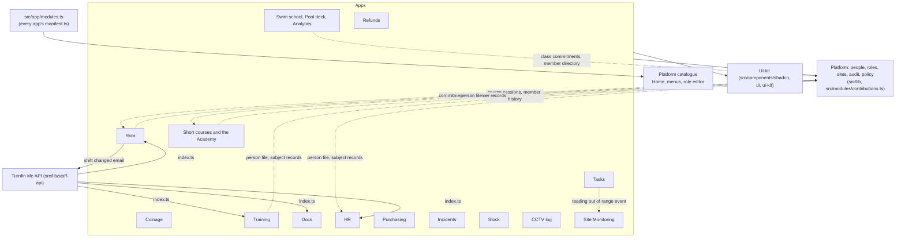

# The app map: what exists today

This page maps Turnfin's code as it is: the layers and their folders, each app and the module that provides it, what each owns, and how they connect. The rules are in [CLAUDE.md](../../CLAUDE.md); the words are in its section 1; where Turnfin is going is in [platform-and-apps.md](platform-and-apps.md).

Turnfin is one Next.js app, one deploy and one main database (Docs and HR have their own), in layers.

## Layers and folders

| Layer | Folders |
| --- | --- |
| **Platform** (Core, ADR 0001) | `src/lib` (people and directory, roles and levels, sites, devices, the policy engine, audit, email, the public API toolkit, Home's data), `src/auth.ts`, `src/platform/events` (the event bus), `src/modules/{registry,contributions,context,server,session-hooks}.ts` (the app catalogue, the plug registries and the wiring); its admin screens in `src/app/(core)` and `src/components/{people,staff,clubs,devices,setup,help}` |
| **UI kit** (ADR 0003) | `src/components/{shadcn,ui,ui-kit}`, `form-dialog`, `confirm-action`, `searchable-picker`; the theme in `src/app/theme` |
| **Apps** | `src/modules/<id>/{index.ts,manifest.ts,module.ts,events.ts,README.md,shared,features}`; each manifest is listed in `src/app/modules.ts` |
| **Front** | `src/components/{home,core,workspace}`, `src/lib/home.ts`, `src/lib/staff-api` (Turnfin Me's API) |
| **Routes** | `src/app`; the swim school's are in the route groups `src/app/(activities)` and `src/app/(instructor)` |

**How an app is packaged.** Its `manifest.ts` gives its name, group, levels and starter page (`href`). Its `module.ts` plugs it into the platform. One page list (`features/workspace/pages.ts`) builds both its page bar and its starter page. Its routes stay thin: the layout checks access and renders the app's frame, and the starter page is one `ModuleStart` call. Home (`/`) lists the apps a person's role opens, and each opens on its starter page ([ADR 0007](decisions/0007-home-hub-and-module-starter-pages.md)).

## Apps

Seventeen apps, provided by fourteen module folders plus the platform (Admin). Groups order Home, the rail and the role editor; they never give access.

| App | Group | Module folder | Tables | Connects through |
| --- | --- | --- | --- | --- |
| Swim school | Front of house | `activities` | `activities.prisma` | class commitments for Rota; the member directory and member history; site summaries; home items; the parent app's API |
| Pool deck | Poolside | `activities` | (the swim school's) | home items |
| Analytics | Managers | `activities` | (the swim school's) | reads desk measures |
| Short courses and the Academy | Front of house | `short-courses` | `short-courses.prisma`, `short-courses.academy.prisma` | books from the member directory ([ADR 0014](decisions/0014-short-courses-book-from-swimmer-records.md)); course sessions for Rota; desk measures; the Academy booking site's API |
| Refunds | Front of house | `refunds` | `refunds.prisma` | home items; desk measures |
| Coinage | Front of house | `coinage` | `coinage.prisma` | home items |
| Tasks | Poolside | `tasks` | `tasks.prisma` | home items; emits `tasks.reading.out_of_range` |
| Incidents | Poolside | `incidents` | `incidents.prisma` | home items; person file and subject records |
| Rota | Team | `rota` | `rota.prisma` | reads commitments; person file; shift-change emails through Turnfin Me |
| Training | Team | `training` | `training.prisma` | person file, subject records, Turnfin Me |
| Docs | Team | `docs` | its own database (`DOCS_DATABASE_URL`) | home items, Turnfin Me |
| HR | Team | `hr` | its own database (`HR_DATABASE_URL`) | reads the person file and subject records |
| CCTV log | Managers | `cctv` | `cctv.prisma` | home items |
| Site Monitoring | Managers | `site-monitoring` | `site-monitoring.prisma` | listens to `tasks.reading.out_of_range` |
| Purchasing | Back office | `purchasing` | `purchasing.prisma` | home items |
| Stock | Back office | `stock` | `stock.prisma` | home items |
| Admin | Back office | the platform (`src/modules/registry.ts`) | `core.prisma`, `base.prisma` | people, roles, sites, setup lists, the activity log |

Each module's README lists its features, front door, tables, events and permissions; each app's rules for people are in `docs/<app>.md` (see [../README.md](../README.md)).

## How apps read the platform

Apps never query or join the platform's tables. They use:
- `src/lib/directory.ts`: people, sites, roles, departments and positions;
- `src/lib/qualifications.ts`: qualification types, what people hold, uploaded certificates;
- `src/lib/setup/activity-types.ts`: the activity list the rota plans;
- `src/lib/people/records.ts`: staff details, for HR;
- `src/lib/audit.ts`: writing the audit log, and an app's own audit trail;
- `src/lib/policy`: who may do what, at which site and over whom.

## Plugs: what apps register with the platform

All in `src/modules/contributions.ts`, registered from each `module.ts`. The platform shows what is registered without knowing who registered it. A source that fails is named on the page, never fatal.

| Plug | What it is for |
| --- | --- |
| `registerHomeCard` | an app's items on Home and its starter page: what needs the person, today's figures, quick actions |
| `registerSiteSummary` | one line per site on Admin › Sites (the swim school: programmes, swimmers, classes) |
| `registerPersonFileSection` | what an app keeps about a person, on their personal file (Rota, Training, Incidents) |
| `registerSubjectRecords` | an app's full records about a person, for HR's subject export |
| `registerCommitments` | who is busy when: the swim school's classes and short-course sessions, which Rota shows as Teaching; a source may also let Rota plan the teacher |
| `registerDeskMeasures` | timed desk jobs (Refunds sent, Academy call-backs) for the swim school's Reception analytics |
| `registerMemberDirectory`, `registerMemberHistory` | the swim school's swimmer records, for Short courses to book people from, and the courses each swimmer has been on |
| `registerAreaRename` | renaming a site's area updates each app that stores area names |
| `registerAppCourses` | the short courses the parent app offers: Short courses registers them, and the swim school's parent API lists and books them |

Other seams: **session hooks** (`src/modules/session-hooks.ts`: per-request work, such as the swim school applying due scheduled unenrolments); **self-registration** of shared UI (the swimmer picker declares itself with `labelsItself`); **links** by URL (Home's *Add a swimmer* opens `/students?add=1`); and **events** ([events.md](events.md)).

**Composition roots** are the only files that import every module: `src/app/modules.ts`, `src/modules/server.ts`, `src/modules/session-hooks.ts`, `src/lib/staff-api/records.ts` and `src/lib/staff-api/reminders.ts`. Shift-change emails go out from `src/lib/staff-api/notify.ts`, which imports no module, so Rota can call it.

**Screens.** Every screen key is in exactly one of `CORE_SCREENS`, `ACTIVITIES_SCREENS` (the swim school) or `OTHER_APP_SCREENS` in `src/lib/staff/screens.ts`; a test checks it.

## Shared plumbing in the platform

- **Public APIs** (`src/lib/public-api/http.ts`): the origin allowlist and CORS, JSON bodies up to 16 KiB, no-store responses, the error envelope and Bearer tokens, for the parent, staff (Turnfin Me) and Academy booking APIs. Each API's own `http.ts` configures it.
- **Email** (`src/lib/email`): the Google transport and one sender (`TURNFIN_EMAIL_FROM`, `TURNFIN_GOOGLE_*`, falling back to `PARENT_*`) for Turnfin Me, the Academy and Refunds. The parent app keeps its own `PARENT_*` sender.

## Databases

- **Main** (`DATABASE_URL`): the platform and every app except Docs and HR. Previews use their own development database; `src/lib/database-environment.ts` stops a preview migrating production ([database-operations.md](../database-operations.md)).
- **Docs** (`DOCS_DATABASE_URL`) and **HR** (`HR_DATABASE_URL`) have their own databases and plain-SQL migrations.

## Activity types

`src/modules/activities/shared/types.ts` defines `ACTIVITY_TYPES`. Swim school is the only one, with the features `progression`, `assessments`, `parentApp`, `waitlists` and `cover`. A second type would give `Programme` an additive `activityType` column (default `"swim-school"`), register the type, and make screens ask `hasFeature` instead of assuming levels and competencies exist.

## Connected products

| Product | Users | Code | Talks to Turnfin through |
| --- | --- | --- | --- |
| Turnfin Me | each member of staff, on their phone | `apps/me` | `/api/staff/v1` ([staff-app.md](../staff-app.md)) |
| Parent app | parents | outside this repository | `/api/parent` ([parent-app.md](../parent-app.md)) |
| Academy booking site | the public | `apps/academy` | the Academy booking API ([academy.md](../academy.md)) |

## Diagram

No module imports another; the boundary lint makes it an error. Solid arrows are calls through a front door (or the platform's notifier); dashed arrows are plugs and events.

## Known follow-ups

These are small leftovers. The larger direction is in [platform-and-apps.md](platform-and-apps.md).
- Tasks and Rota each keep their own `addDays`; one date helper belongs in the platform.
- The email code check (sign-in and booking codes) and the rate limit are each kept by the parent, staff and Academy APIs; both belong in the platform.
- `src/app/theme/docs-shell.css` and `docs-integration.css`, shared by Docs and Refunds, keep their Docs-era names.
- `AuditLog.programmeId` is swim-school-shaped; the module-neutral `module` column is what the activity log filters by.
